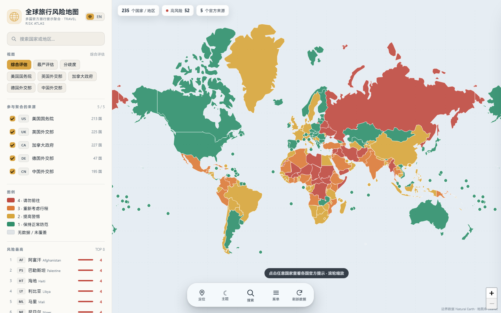
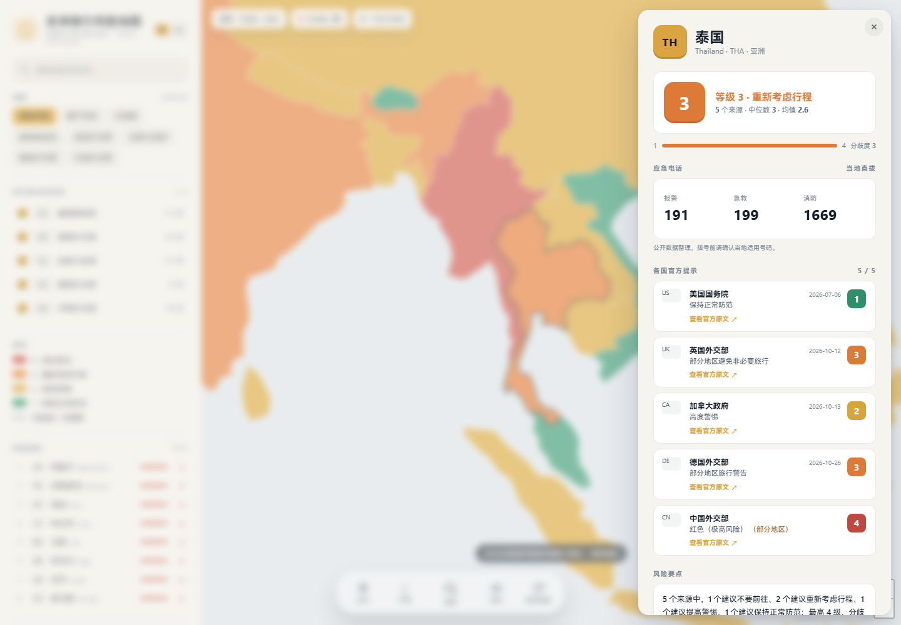
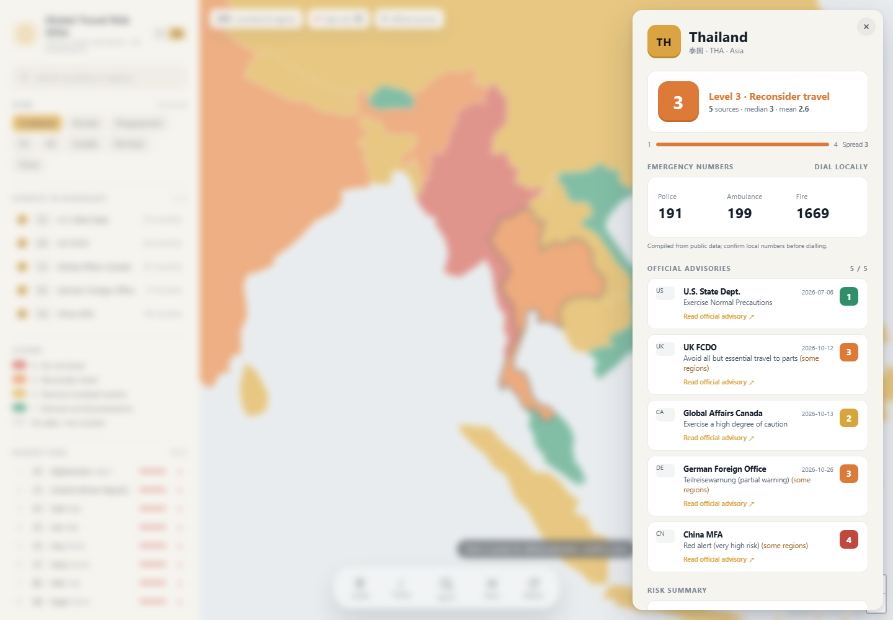
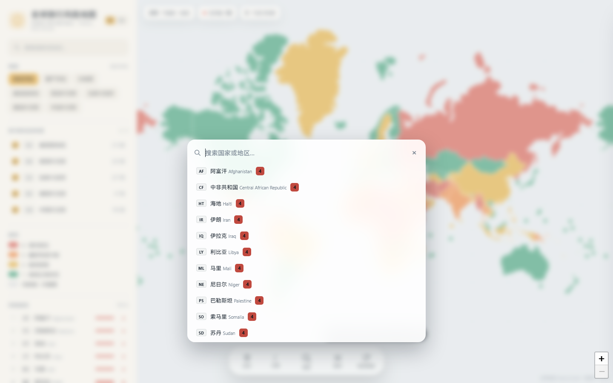
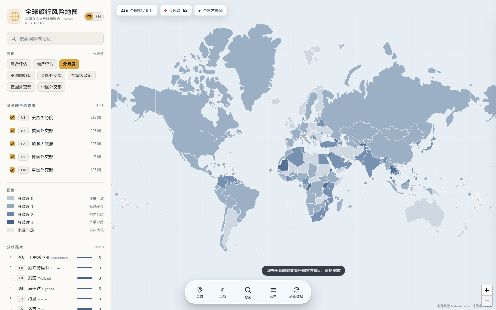
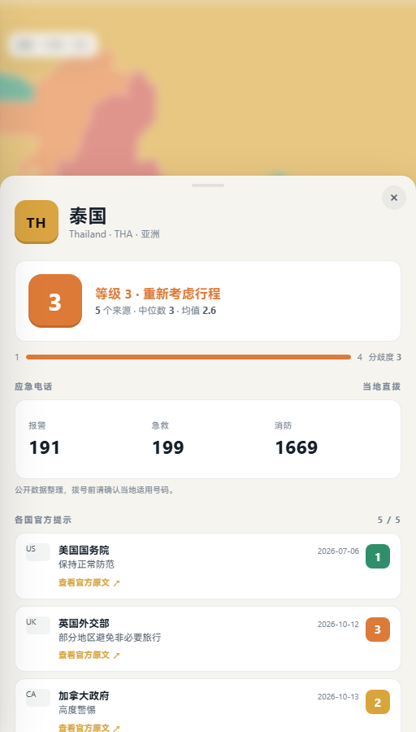
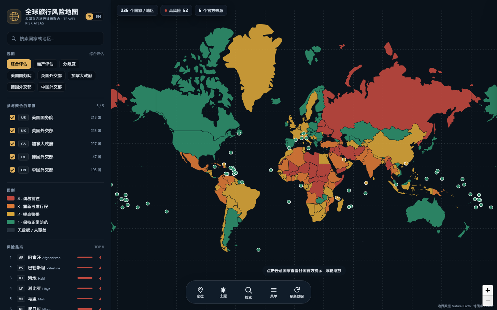

# ReadyToGo · 全球旅行风险地图

把**美国、英国、加拿大、德国、中国**政府面向本国公民发布的境外旅行提示，归一化到统一的 1–4 级风险尺度，
以可交互的世界地图并列展示 235 个国家/地区，并在详情页给出当地**报警 / 急救 / 消防**应急电话。

你可以一眼看出：某个国家各国政府分别怎么评级、它们是否意见一致、哪里的风险最高，以及万一出事该拨什么号码。

> 本工具只做**信息聚合与可视化**，不自行评定任何国家的风险等级；所有等级都来自官方原文，出行前请以原文为准。



---

## 快速开始

只需要 Python 3.9+（无第三方依赖）：

```bash
cd travel-risk-map
python serve.py            # 打开 http://127.0.0.1:8765
```

`serve.py` 是一个零依赖的静态服务器。也可以用任意静态服务器托管 `web/` 目录，
例如 `python -m http.server 8765 --directory web`。

界面支持**中文 / English** 切换（侧边栏顶部 `中 / EN`），以及**浅色 / 深色主题**切换（底部导航 ☀/☾，
默认跟随系统并记住选择），国家名、官方措辞、风险要点与方法说明都会随语言切换；
也可以用 `?lang=en`、`?theme=dark` 直接以指定语言/主题打开。
数据已随仓库提供，**完全离线可用**。

---

## 每天 0 点更新

刷新分两层：

1. **抓取与构建**（PC / 服务器）
   - `python scripts/daily_update.py`：`fetch_sources.py --force` → `build_data.py` → 同步 Harmony rawfile；
   - Windows 注册每天 00:00 的任务：
     ```powershell
     powershell -ExecutionPolicy Bypass -File scripts\install_daily_task.ps1 -Python "C:\path\to\python.exe"
     ```
   - GitHub 仓库可直接用 `.github/workflows/daily-data.yml`：每天 UTC 16:00（北京时间 00:00）
     抓取、提交数据并部署 `web/` 到 GitHub Pages。

2. **应用内拉取**（已安装的 App）
   - 把 `web/data/` 发布到任意 HTTPS 静态站点（Pages / OSS / 自己的服务器），
     在 [`web/data/remote.js`](web/data/remote.js) 填入：
     ```js
     window.__REMOTE_DATA__ = 'https://your.site/readytogo/data/';
     ```
   - App 会在**启动、每天 0 点、回到前台**时拉取 `risk.json` / `countries.geojson`，
     成功后缓存到 localStorage，离线或失败时继续使用内置数据；
   - 这个地址需要重新打包一次 HAP 带进去，之后每天更新数据**不再需要重装**。

> 鸿蒙安装包本身是离线的：没有配置远程地址时，它只能跟随 HAP 更新，无法自行获取新数据。

---

## 功能

- **四种视图**
  - `综合评估`：所选来源等级的中位数（偏保守），代表多国共识。
  - `最严评估`：取最高等级，代表最谨慎政府的判断。
  - `分歧度`：最高与最低等级之差（0–3），一眼找出「各国吵得最凶」的目的地。
  - `美国 / 英国 / 加拿大 / 德国 / 中国`：单独查看某一国政府的评级。
- **来源开关**：侧边栏可勾选参与聚合的来源，地图、图例和排名实时重算。
- **国家详情**：点击任意国家，右侧（移动端为底部抽屉）展示
  - 综合等级、来源数量、中位数与均值、等级区间与分歧度；
  - **应急电话**：报警、急救、消防、统一紧急号码，仅作展示（不可点击）；
  - 每个来源的原始等级、官方措辞、更新日期、官方原文链接；
  - 「部分地区」警告标记；
  - **风险要点**：按所选来源的等级分布自动生成一句话摘要，并附同语种的官方原文摘录
    （中文模式用中国外交部安全提醒，英文模式用美国国务院摘要）。
- **搜索与排名**：国家/地区即时搜索、风险最高 TOP 8、点击定位并飞行到该国。
- **循环平移**：世界地图横向无缝循环，跨过 180°（白令海峡）不会跳转或刷新；世界副本按需在屏幕外追加/回收，可以一直向东/向西拖动。
- **中英文切换**：中文 / English 一键切换，详情与风险要点同步换语言；`?lang=en` 可分享英文链接。
- **深浅色主题**：底部导航 ☀/☾ 一键切换，默认跟随系统偏好并记忆；地图、侧边栏、详情与弹窗整体换色，`?theme=dark` 可分享深色链接。
- **底部悬浮导航**：定位 / 主题 / 搜索 / 菜单 / 刷新数据，搜索居中且图标略大，移动端单手可达。
- **全局搜索**：点底部「搜索」弹出居中搜索框，输入国家名即时筛选，回车或点击直接定位。
- **刷新风险数据**：点「刷新数据」重新拉取 `risk.json` / 国界数据并原地重建地图；离线壳内则重新加载打包快照。
- **返回手势**：系统返回 / 左右侧滑优先关闭当前弹窗（搜索 → 详情 → 菜单），没有弹窗时才退出应用。
- **定位到所在国家**：点击「定位」读取当前位置，按经纬度识别国家并聚焦、打开该国详情；无权限或识别失败时给出提示。
- **弹窗聚焦**：打开国家详情或方法说明时，其余界面自动模糊；点击模糊区域即可关闭。
- **应急电话**：报警 / 急救 / 消防以与风险等级同尺寸的卡片展示，仅作信息展示、不可点击。
- **排版**：中文使用随项目打包的 HarmonyOS Sans SC，英文优先使用平台的 San Francisco（详见下文「字体与主题」）。
- **分享链接**：`#JP` 直接打开日本详情，`?mode=spread` 直接进入分歧度视图。
- **响应式**：桌面为侧边栏 + 全屏地图；手机上地图全屏、详情为底部抽屉，**支持下滑 / 侧滑关闭，点击模糊背景也可关闭**。



<p align="center"><em>English interface: risk summary and official excerpt follow the selected language.</em></p>



全局搜索：



<p align="center">
  
  
</p>

深色主题：



---

## 数据来源

| 代码 | 机构 | 等级体系 | 覆盖 | 入口 |
| --- | --- | --- | --- | --- |
| `us` | 美国国务院（U.S. Department of State） | 1–4 级 | 214 | [Travel Advisories](https://travel.state.gov/content/travel/en/traveladvisories/traveladvisories.html) |
| `uk` | 英国外交、联邦及发展事务部（FCDO） | 警告类型（全国/部分地区 × 不要前往/避免非必要） | 226 | [Foreign travel advice](https://www.gov.uk/foreign-travel-advice) |
| `ca` | 加拿大全球事务部（Global Affairs Canada） | 1–4 级 | 228 | [Travel advice and advisories](https://travel.gc.ca/travelling/advisories) |
| `de` | 德国外交部（Auswärtiges Amt） | 正式旅行警告 / 部分地区警告 | 47 | [Reise- und Sicherheitshinweise](https://www.auswaertiges-amt.de/en/aussenpolitik/laender) |
| `cn` | 中国外交部 · 中国领事服务网 | 红 / 橙 / 黄 / 蓝四色风险 | 195 | [了解目的地](https://cs.mfa.gov.cn/ljmdd/) |

- 旅行提示为 **2026-11-07** 的抓取快照（见 `web/data/risk.json` 的 `generated_at`）。
- 应急电话来自公开整理的各国紧急号码表（原始数据为 Wikipedia
  [List of emergency telephone numbers](https://en.wikipedia.org/wiki/List_of_emergency_telephone_numbers)，
  经 [JSON 数据集](https://github.com/shanezzar/JSON-of-emergency-telephone-numbers) 整理），已覆盖 227 个国家/地区。

### 等级归一化

| 来源 | → 1 | → 2 | → 3 | → 4 |
| --- | --- | --- | --- | --- |
| 美国 | Exercise Normal Precautions | Exercise Increased Caution | Reconsider Travel | Do Not Travel |
| 加拿大 | Exercise normal security precautions | Exercise a high degree of caution | Avoid non-essential travel | Avoid all travel |
| 英国 | 无警告 | （英国不设此级） | Avoid all but essential travel | Avoid all travel |
| 德国 | 无正式警告（不计入） | （德国不设此级） | Teilreisewarnung | Reisewarnung |
| 中国 | 蓝色（低风险） | 黄色（中风险） | 橙色（高风险） | 红色（极高风险） |

几个刻意的取舍：

- **英国、德国、中国的「部分地区警告」**按该国最高等级计入，并标记「部分地区」。
- **德国只在发布正式警告时计入**（无警告 ≠ 安全），避免把「未警告」稀释成 1 级。
- 美国、英国、加拿大、中国的「无警告 / 低风险」视为 1 级。
- 所有等级都是**面向该国公民**的判断，受使馆能力、双边关系、旅行者画像影响，不等于客观安全度。

### 聚合公式

设所选来源的等级集合为 `L`：

- 综合等级 = `round(median(L))`（偶数个来源取中间两值平均后四舍五入，偏保守）
- 均值、最小值、最大值、分歧度 = `max(L) - min(L)`
- 详情页同时给出中位数与均值，避免单一数字掩盖分歧

### 应急电话

- 每个国家/地区给出**报警（police）/ 急救（ambulance）/ 消防（fire）**号码，若某号码覆盖多个服务则合并展示。
- 同一号码完全相同（如美国 911）时只显示一个「紧急」按钮，避免重复。
- 点击按钮触发 `tel:` 拨号；号码可能因地区、运营商而异，拨号前请确认当地适用号码。

---

## 打包成鸿蒙应用

仓库中的 [`harmony/`](harmony/README.md) 是一个 HarmonyOS（ArkTS Stage 模型）工程：
用 ArkUI `Web` 组件加载 `rawfile/web` 里的现有应用，复用地图、数据、中英文、深浅色与字体，
无需重写地图逻辑。

```bash
python scripts/build_data.py              # 重建数据
python scripts/sync_harmony_assets.py     # 同步 web/ → harmony/.../rawfile/web
```

然后用 DevEco Studio 5.0+（API 12）打开 `harmony/` 运行。工程已在 DevEco Studio 中
构建成功（生成 unsigned HAP）；安装到真机需在 IDE 中配置签名。
具体步骤与注意事项见 [harmony/README.md](harmony/README.md)。

---

## 工作原理

```
scripts/fetch_sources.py                scripts/build_data.py                 web/
┌──────────────────────┐   raw JSON/HTML  ┌──────────────────────┐   risk.json   ┌──────────────┐
│  US CA API           │ ───────────────▶ │  解析 / 名称匹配      │ ────────────▶ │  地图应用     │
│  UK GOV.UK Content   │   data/raw/      │  等级归一化           │ countries.    │  Leaflet     │
│  CA advisories HTML  │                  │  聚合 / 生成 GeoJSON  │ geojson       │  纯前端       │
│  DE open data        │                  │  合并应急电话         │               │              │
│  CN 领事服务网        │                  └──────────────────────┘               └──────────────┘
│  EM 应急号码数据集     │
└──────────────────────┘
```

- `scripts/fetch_sources.py`：下载五国原始数据（英国 226 个国别页、中国 195 个国别页并发抓取）与应急号码，
  缓存到 `data/raw/`；已存在则跳过，`--force` 强制刷新。
- `scripts/build_data.py`：把国家名映射到 ISO 3166-1（英文别名表 + 中文别名表，兼容
  Burma/Myanmar、Cabo Verde/Cape Verde、刚果（金）/刚果（布）等写法），归一化等级，生成
  `web/data/risk.json` 与 `web/data/countries.geojson`（110m Natural Earth，坐标压缩到约 1 km）。
- 前端是零构建的原生 JS + 本地 Leaflet，无 CDN 依赖；数据约 1 MB，另含约 8.8 MB 中文字体，首屏无需联网。

### 字体与主题

- **中文**：随项目打包 HarmonyOS Sans SC（Regular + Bold，WOFF2，约 8.8 MB），通过 `unicode-range` 只接管 CJK 字符，不干扰英文排版。
- **英文**：优先使用平台的 San Francisco（`-apple-system` / `SF Pro Text`）；非 Apple 平台自动回退到系统无衬线字体（Segoe UI、Helvetica Neue 等），因为 SF Pro 不允许随项目分发。
- **主题**：基于 CSS 变量实现（`[data-theme="light|dark"]`），切换时同步 Leaflet 的国界色与无数据色。
- 主题与语言都保存在 `localStorage`，也可用 `?theme=` / `?lang=` 覆盖。
- HarmonyOS Sans 版权归华为所有，见 [`web/fonts/NOTICE.txt`](web/fonts/NOTICE.txt)。

### 目录结构

```
travel-risk-map/
├─ serve.py                  # 零依赖静态服务器
├─ web/                      # 应用（可直接静态托管）
│  ├─ index.html
│  ├─ app.js                 # 全部交互逻辑（无框架）
│  ├─ style.css
│  ├─ vendor/leaflet.*       # 本地 Leaflet 1.9.4
│  ├─ fonts/                 # HarmonyOS Sans SC（中文）+ NOTICE
│  └─ data/
│     ├─ risk.json           # 235 个国家/地区 × 5 来源 + 聚合 + 应急电话
│     └─ countries.geojson   # 世界边界（含 ISO2 / 中英文名）
├─ scripts/
│  ├─ fetch_sources.py       # 抓取官方数据
│  ├─ build_data.py          # 解析、归一化、聚合、生成前端数据
│  ├─ sync_harmony_assets.py # web/ → 鸿蒙 rawfile
│  └─ make_icons.py          # 生成鸿蒙应用图标
├─ harmony/                  # HarmonyOS ArkTS 工程（Web 组件壳）
├─ data/raw/                 # 原始快照（可离线重建）
│  ├─ cn/                    # 中国 195 个国别页
│  ├─ uk/                    # 英国 226 个国别页
│  └─ emergency.json         # 应急号码
├─ docs/                     # 截图
└─ README.md
```

---

## 更新数据

```bash
python scripts/fetch_sources.py      # 抓取最新官方数据（含中国 195 页）
python scripts/build_data.py         # 重建 web/data/*
```

只重建、不联网也可以：`data/raw/` 中已包含本次快照。

## 扩展新来源

1. 在 `scripts/fetch_sources.py` 增加抓取函数，把原始数据写入 `data/raw/`；
2. 在 `scripts/build_data.py` 写一个 `parse_xx()`，返回 `{ISO2: {level, label_en, label_zh, updated, url, partial}}`；
3. 在 `SOURCES` 中登记来源元数据，并把解析结果加入 `src` 字典；
4. 前端把来源代码加入 `SRC_ORDER` 即可自动出现在图例、开关和详情中。

日本（MOFA 危険情報，1–4 级）与澳大利亚（Smartraveller，1–4 级）是合适的候选来源；本次未接入的原因是
日本的风险数据由 WebGIS 图层渲染、澳大利亚站点对自动抓取限制较严，需要单独解析方案。

---

## 已知局限

- **口径不同**：各国提示面向本国公民，评级受使馆能力与双边关系影响；同一国家 2 级与 3 级之间
  并不存在国际统一阈值。
- **地域颗粒度不同**：英国、德国、中国大量警告只针对特定地区，本工具按全国最高等级展示，并在详情中
  标注「部分地区」，因此可能高估整体风险（例如泰国南部三府）。
- **时间不同步**：各来源更新频率从数天到数年不等；中国领事服务网页面未提供逐条更新日期，详情中不显示日期。
- **应急电话**：来自公开整理的数据集，可能因地区、运营商或政策变化而过时；部分小岛屿属地没有收录。
- **覆盖不完整**：美国对本国不发布旅行提示；部分小岛屿属地只有个别国家覆盖，可能只显示 1–2 个来源。
- **数据快照**：页面展示抓取时点的内容，政策变化后需重新运行抓取脚本。

## 免责声明

本项目仅供出行研究与数据可视化参考，**不构成任何安全建议**。旅行提示与应急号码可能随时变化，
请务必查阅各国外交部门官方原文，并以当地官方信息为准。代码以 MIT 许可发布；
原始提示内容版权归各发布政府所有，应急号码原始数据来自 Wikipedia（CC BY-SA）。
